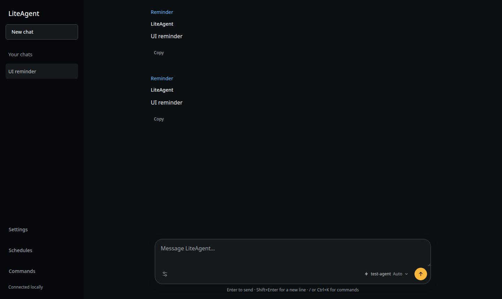

# LiteAgent

A local assistant with a web chat, browser automation, text-file tools, saved procedures and scheduled reminders. One Go executable serves the interface and runs the agent.



**Version 0.3.0.** The interface is in English; the assistant responds in your language. Screenshots use synthetic test data. This repository contains source and documentation, not user conversations, API keys or browser sessions.

## Features

- Ollama, OpenAI-compatible APIs, OpenAI Responses and Anthropic.
- Model and reasoning controls in the message composer.
- Chrome automation and local text-file inspection, creation and editing.
- Saved procedures, cron jobs, reminders and notification sounds.
- Settings for connections, timeouts, notifications, schedules, skills and MCP servers.
- Persistent local conversations, including deletion while a reply is running.

## Run from source

Requirements: **Go 1.25+** and a local or remote model that supports tools. Chrome is needed for browser actions; ChromeDriver is discovered or downloaded on first use.

```bash
git clone https://github.com/slgarza/LiteAgent.git
cd LiteAgent
go run ./cmd/liteagent serve
```

Open **http://127.0.0.1:8787** and configure **Settings → Models & API keys**. You can fetch model IDs before saving a connection. Remote providers require API credentials; subscription logins are not imported.

```bash
# Start without opening the chat tab automatically.
go run ./cmd/liteagent serve --no-open

# Use the terminal interface.
go run ./cmd/liteagent chat

# Choose a private runtime data directory.
go run ./cmd/liteagent serve --data /path/to/private-data
```

The default data directory is the OS user configuration directory plus `LiteAgent`, separate from this source tree. Request timeout defaults to **900 seconds**; the complete run deadline defaults to **1800 seconds**. Both are configurable in Settings.

## Interface

| Model and reasoning | Schedules in Settings |
| --- | --- |
|  |  |

[More screenshots](docs/screenshots/README.md) · [User guide](docs/USAGE.md) · [Filesystem tools](docs/FILESYSTEM.md)

## Build and verify

```bash
go test -race ./...
go vet ./...
./scripts/build.sh
```

Packaging requires Bash and Python 3 and creates Linux/Windows AMD64 packages in `dist/`. Node.js is not required at runtime. For Chrome tests and screenshot generation, see [Development](docs/DEVELOPMENT.md).

## Project layout

```text
cmd/liteagent/       Executable entry point
internal/app/       Runtime, tools, providers, storage, API and tests
web/                Embedded HTML, CSS and JavaScript
scripts/            Builds, packaging and repository checks
docs/               User guide, architecture and development notes
docs/screenshots/   Screenshots from isolated fixtures
AGENTS.md           Instructions for coding agents
CHANGELOG.md        Changes and release notes
```

See [Architecture](docs/ARCHITECTURE.md) and [CHANGELOG.md](CHANGELOG.md).

## Local data and limits

Chats, provider keys, MCP tokens, schedules, downloads and browser cookies belong to the runtime data directory and must not be committed. Credentials are stored locally without encryption, subject to OS file permissions. Remote models receive conversation context and relevant tool results. See [Data and publishing](docs/DATA.md).

One agent operation runs at a time. Scheduled work needs the application and computer running; desktop alerts also need an open tab and browser permission. File tools handle UTF-8 text up to 1 MiB, without shell execution, deletion or binary document parsing. Windows packages are cross-compiled; runtime behavior is verified on Linux and still needs Windows validation.

## License

The existing [proprietary license](LICENSE) is retained. A public repository does not grant an open-source license. Third-party terms are in [THIRD_PARTY_NOTICES.txt](THIRD_PARTY_NOTICES.txt) and [web/LICENSES.txt](web/LICENSES.txt).
