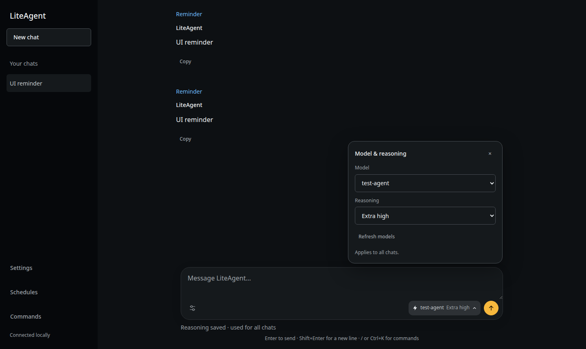
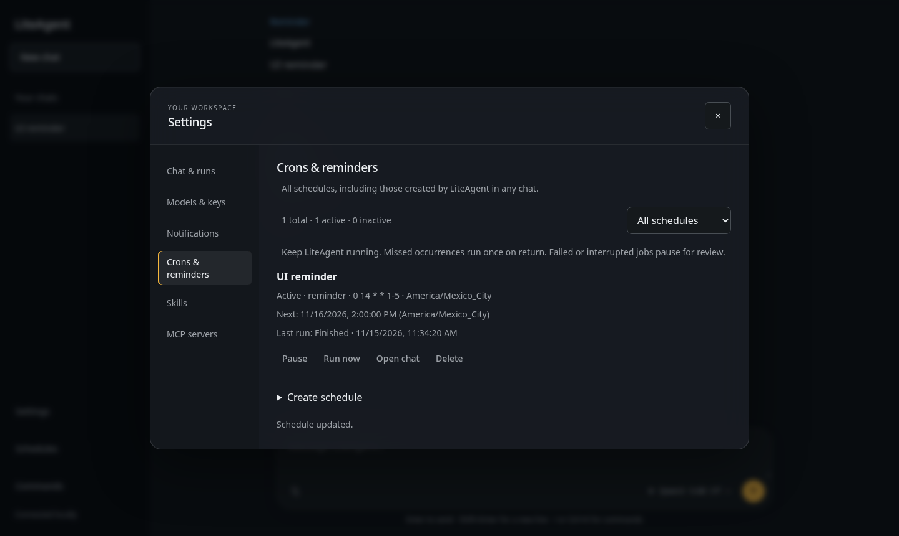

# LiteAgent

A local assistant with a web chat, browser automation, text and Office file tools, saved procedures and scheduled reminders. One Go executable serves the interface and runs the agent.


**Version 0.3.0.** The interface is in English; the assistant responds in your language. Screenshots use synthetic test data. This repository contains source and documentation, not user conversations, API keys or browser sessions.

## Features

- Ollama, OpenAI-compatible APIs, OpenAI Responses and Anthropic.
- VS Code as a model provider through the optional local bridge extension.
- Model and reasoning controls in the message composer, with optional collapsible model-provided thinking.
- Automatic discovery of installed Ollama models and first-run setup guidance.
- Windows production executable without a console; Quit from the interface.
- Chrome automation and local text-file inspection, creation and editing.
- Reading and editing existing Excel, Word and PowerPoint documents, without an Office runtime.
- Agent Skills packages imported from ZIP, folders or public GitHub, with editable resources and OpenClaw/Hermes metadata preservation.
- Saved procedures used on request, cron jobs, reminders and notification sounds.
- Detailed session status with provider-reported tokens, cache, context, execution and queue information.
- Settings for connections, timeouts, notifications, schedules, skills and MCP servers.
- Persistent local conversations and retrievable action records, including after failed replies.
- Configurable limits: 30 successful actions per reply by default, with failures counted separately.

## What do I need to run it?

| What you have | What you need |
| --- | --- |
| Source downloaded from GitHub | Go **version 1.25 or newer** to compile or run it |
| An already compiled Linux/Windows package | Extract it and run the executable; Go, Python and Node.js are not required |
| Either option | Configure a remote API, a local model through Ollama, or the optional VS Code model bridge |
| Browser automation | Chrome installed; ChromeDriver is discovered or downloaded on first use |

**Go**, also called **Golang**, is the programming language and compiler used to build LiteAgent. “Go 1.25” means version 1.25, not a separate application you must keep running alongside a compiled LiteAgent.

**This GitHub repository currently provides source code only.** The `dist/` directory is generated locally and excluded from Git. **Code → Download ZIP** downloads source, not a ready-to-run application. Compiled packages have not been published as GitHub Releases.

## Run from GitHub source

Install Go 1.25 or newer. Clone with Git, or extract **Code → Download ZIP** and open a terminal in the extracted folder containing `go.mod`.

```bash
git clone https://github.com/slgarza/LiteAgent.git
cd LiteAgent
go run ./cmd/liteagent serve
```

`go run` compiles and starts the app in one step on Linux and Windows. To create a reusable executable instead, run the following commands from the project folder.

**Linux:**

```bash
go build -o liteagent ./cmd/liteagent
./liteagent
```

**Windows (PowerShell):**

If you downloaded the GitHub ZIP:

1. In File Explorer, choose **Extract All** for the ZIP. Do not run commands inside the compressed archive.
2. Open the extracted folder containing **`go.mod`**, **`cmd`**, **`internal`** and **`web`**. Extraction can leave a `LiteAgent-main` folder inside another folder; enter the inner project folder if necessary.
3. Click File Explorer's address bar, type `powershell` and press Enter. This opens PowerShell in that folder.
4. Check the location with `Test-Path .\go.mod`. It must return **`True`** before you build.

```powershell
if (Test-Path .\go.mod) {
    go build -tags desktop -ldflags "-H=windowsgui" -o LiteAgent.exe ./cmd/liteagent
    if ($LASTEXITCODE -eq 0) { .\LiteAgent.exe }
} else {
    Write-Host "Open PowerShell in the extracted LiteAgent folder containing go.mod."
}
```

**`go.mod file not found`** means the command was run outside the project folder, or the source was not fully extracted. After that failure, **`.\LiteAgent.exe is not recognized`** follows because compilation did not create the executable there. Enter the folder containing `go.mod` and compile again; do not create a new module with `go mod init`.

Once compiled, subsequent launches use only the executable and do not need Go.

This Windows build opens the browser without a terminal window. Use **Quit LiteAgent** in the sidebar to stop the server. Closing the browser tab leaves the server running; reopening the executable brings back the same instance. `go run ./cmd/liteagent serve` keeps the development console. For terminal commands and diagnostics, build `go build -o LiteAgent-console.exe ./cmd/liteagent` instead.

Open **http://127.0.0.1:8787** and configure **Settings → Models & API keys**. You can fetch model IDs before saving a connection. Remote providers require API credentials; subscription logins are not imported.

```bash
# Start without opening the chat tab automatically.
go run ./cmd/liteagent serve --no-open

# Use the terminal interface.
go run ./cmd/liteagent chat

# Choose a private runtime data directory.
go run ./cmd/liteagent serve --data /path/to/private-data
```

The default data directory is the OS user configuration directory plus `LiteAgent`, separate from this source tree. Request timeout defaults to **900 seconds**; the complete run deadline defaults to **1800 seconds**. Both are configurable in Settings.

## Set up a local model with Ollama

1. [Install Ollama](https://ollama.com/download) and open it. If it is not already running, start it with `ollama serve` in a separate terminal.
2. Download a small model from PowerShell or a terminal:

   ```bash
   ollama pull qwen3:0.6b
   ```

3. Open LiteAgent and choose the installed model beside Send. The list refreshes automatically while idle; **Check again** or **Refresh models** updates it immediately.

[Qwen3 0.6B](https://ollama.com/library/qwen3:0.6b) is a small starting option for basic chat; its ability to perform complex tasks with tools is limited. LiteAgent shows setup steps if Ollama is unavailable or has no models. It lists installed models without loading all of them into memory, and requests the selected model when you chat.

For the larger Qwen3 8B GGUF model:

```bash
ollama run hf.co/Qwen/Qwen3-8B-GGUF:Q4_K_M
```

This downloads the model and starts a terminal chat. Enter `/bye` to leave that chat while keeping Ollama running. In LiteAgent, select the exact `hf.co/Qwen/Qwen3-8B-GGUF:Q4_K_M` entry; it is a different model ID from `qwen3:8b`. See the [Qwen model card](https://huggingface.co/Qwen/Qwen3-8B-GGUF) and [Ollama CLI reference](https://docs.ollama.com/cli). Model downloads require internet access; larger models require more memory. LiteAgent does not bundle Ollama or model weights.

## Route requests through VS Code

Install the optional LiteAgent bridge extension, start it from VS Code's command palette and add a **VS Code · model bridge** connection in LiteAgent. It fetches the models exposed by VS Code and routes requests to the model you select. Keep VS Code open; provider permissions and quotas apply. The bridge does not read chat panels or import account credentials.

Build the extension locally with `python3 scripts/build-vscode-bridge.py` (Windows: `py scripts/build-vscode-bridge.py`). See the [setup guide](docs/VSCODE.md) for requirements, installation and model authorization.

## Run an already compiled package

These instructions apply if you have a package built locally with `scripts/build.sh` or supplied separately; the packages are not currently downloadable from this repository.

- **Windows:** extract `LiteAgent-windows-amd64.zip`, then double-click `LiteAgent.exe`.
- **Linux:** extract `LiteAgent-linux-amd64.zip`, open a terminal in that folder and run `./liteagent`. If the executable permission was lost during extraction, run `chmod +x liteagent` first.

Both open the chat at **http://127.0.0.1:8787**. On Windows, the production executable runs without a console; **Quit LiteAgent** stops it. The package also includes `LiteAgent-console.exe` for terminal use. On Linux, keep the terminal open; Ctrl+C or **Quit LiteAgent** stops the server. Scheduled work needs the server running, and browser notifications also need an open tab. You still need to configure a model; Chrome is needed only for browser automation.

## Interface

| Model and reasoning | Schedules in Settings |
| --- | --- |
|  |  |

[More screenshots](docs/screenshots/README.md) · [User guide](docs/USAGE.md) · [Filesystem tools](docs/FILESYSTEM.md)

## Build and verify

```bash
go test -race ./...
go vet ./...
./scripts/build.sh
```

Packaging requires Bash and Python 3 and creates Linux/Windows AMD64 packages in `dist/`. Node.js is not required at runtime. For Chrome tests and screenshot generation, see [Development](docs/DEVELOPMENT.md).

## Project layout

```text
cmd/liteagent/       Executable entry point
internal/app/       Runtime, tools, providers, storage, API and tests
web/                Embedded HTML, CSS and JavaScript
scripts/            Builds, packaging and repository checks
docs/               User guide, architecture and development notes
docs/screenshots/   Screenshots from isolated fixtures
AGENTS.md           Instructions for coding agents
CHANGELOG.md        Changes and release notes
```

See [Architecture](docs/ARCHITECTURE.md) and [CHANGELOG.md](CHANGELOG.md).

## Local data and limits

Chats, provider keys, MCP tokens, schedules, downloads and browser cookies belong to the runtime data directory and must not be committed. Credentials are stored locally without encryption, subject to OS file permissions. Remote models receive conversation context and relevant tool results. See [Data and publishing](docs/DATA.md).

One agent operation runs at a time. Scheduled work needs the application and computer running; desktop alerts also need an open tab and browser permission. File tools handle UTF-8 text up to 1 MiB and read/edit existing Excel `.xlsx`, Word `.docx` and PowerPoint `.pptx` files up to 32 MiB. Office support covers worksheet values/formulas and document/slide text; it does not calculate formulas, render images or control Office windows. Legacy `.xls/.doc/.ppt`, PDFs and encrypted/macro-enabled documents are unsupported. There is no shell execution or file deletion. Windows packages are cross-compiled; runtime behavior is verified on Linux and still needs Windows validation.

## License

The existing [proprietary license](LICENSE) is retained. A public repository does not grant an open-source license. Third-party terms are in [THIRD_PARTY_NOTICES.txt](THIRD_PARTY_NOTICES.txt) and [web/LICENSES.txt](web/LICENSES.txt).
