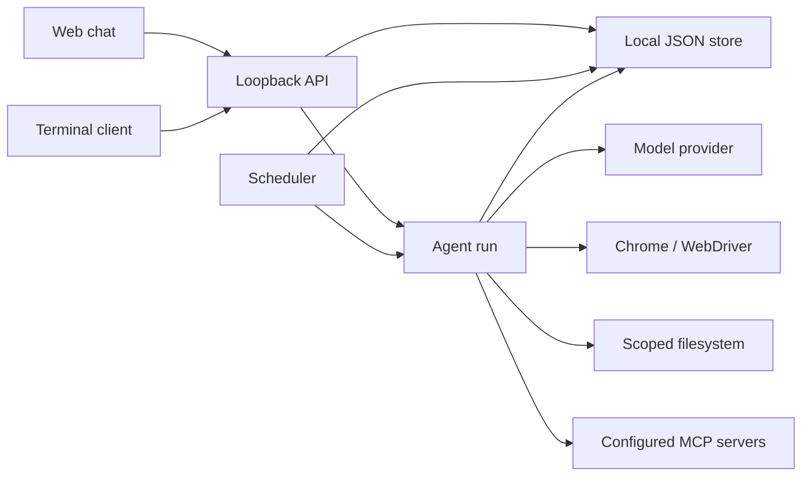

# Architecture

[Project README](../README.md)

One process binds to loopback, serves embedded assets, stores durable state and runs the scheduler. The web and terminal clients use the same API. There is no hosted backend.

## Source map

| Location | Responsibility |
| --- | --- |
| `cmd/liteagent/main.go` | Process entry |
| `internal/app/service.go` | Flags, listener, data lock, startup/shutdown |
| `internal/app/lifecycle.go`, `mode_*.go`, `process_*.go` | Desktop relaunch checks, Quit endpoint, build mode and child console behavior |
| `internal/app/server.go` | Routing, public state, run launch/cancellation, chat deletion |
| `internal/app/agent.go` | Context and model/tool loop |
| `internal/app/provider.go`, `responses.go` | Model protocols |
| `internal/app/filesystem.go`, `desktop_*.go` | File tools and Desktop discovery |
| `internal/app/office.go`, `office_sheet.go` | Bounded OOXML reading and targeted document/spreadsheet edits |
| `internal/app/browser.go`, `driver.go` | WebDriver and driver installation |
| `internal/app/scheduler.go`, `schedules_api.go` | Jobs and durable occurrence claims |
| `internal/app/store.go` | Serialized state mutations and atomic persistence |
| `internal/app/commands.go`, `chat_commands.go`, `cli.go` | Commands and terminal client |
| `internal/app/connections.go`, `settings.go`, `mcp.go` | Connections, generation settings, MCP |
| `internal/app/notifications.go` | Completed events for browser alerts |
| `web/` | Embedded chat, settings and notifications |
| `extensions/vscode-bridge/` | Optional local HTTP bridge into VS Code's public Language Model API |

Tests live beside implementation. The `web` package embeds only UI files, excluding runtime data and documentation screenshots.

## Execution

`runMu` serializes active-run transitions, queue mutations and steering delivery. Skill preloading uses explicit IDs only; keyword ranking is confined to the requested `skills_search` tool. The system prompt and skill tool descriptions require user intent before discovery/use. A run persists its chat/record and captures configuration before starting the worker. The worker saves events and final status, finishes any linked schedule and clears active state. Cancellation stops requests and closes tools; it cannot undo completed actions. Successful calls and failures have independent budgets (30 and 10 by default). Exhausting either gives one tool-free final model request; pending batch calls receive skipped results to preserve protocol pairing. Ambiguous MCP errors still stop immediately.

Pending messages are persisted separately from runs. A queued message is claimed in the same `Store.Update` transaction that creates its run, preserving the submission ID. Only one worker runs; queued work starts after the previous worker’s tool cleanup. The scheduler also checks ready queued work before scheduled agent jobs. Pending work pauses on Stop, unsuccessful replies and restart. Terminal queue records retain submission IDs for deduplication and are removed with the conversation.

Steering targets an explicit active run in the same chat. The worker consumes pending instructions and records their user events atomically at model/tool boundaries. Remaining tool calls receive skipped results before the new user instruction, preserving provider protocol pairing. Accepting the final model response seals the run under `runMu`, so late steering stays queued. In-flight tools finish normally; steering does not retry external actions.

Deleting another chat leaves the active run alone. Deleting the active chat marks it pending, cancels and waits on its completion channel without holding `runMu`. The chat, runs and linked schedules are then removed in one store update. An interrupted delete request keeps the conversation for a later retry.

Filesystem operations use a separate lock. Office tools share the same `os.Root` and replacement/hash path as text tools. Bounded ZIP packages are interpreted through their relationships; changed XML is patched by byte range and untouched package parts are copied without reserialization. Worksheet edits invalidate the calculation chain and request recalculation in the spreadsheet application. Store updates do not take that lock. Avoid waiting for a worker while holding any lock it needs.

Cross-turn context combines bounded user/reply text with deterministic summaries derived from saved tool/observation/error events. These include run/event references and distinguish an error or missing result from confirmed execution. `conversation_history` provides paginated lookup within the current chat and reset boundary; it never returns thinking events. This also recovers actions saved before a failed final answer. No extra summarization model is used.

Within a run, compaction copies messages without changing the original log, tool-call IDs or provider reasoning blocks. The newest three tool results stay intact; large older outputs retain head/tail excerpts and saved-event references. Stored event text is still bounded to 18,000 characters. History retrieval is bounded and cancellation-aware; it cannot prove current page/file state.

`usage.go` captures only documented numeric response fields through a request-local context value. Usage is never serialized into model messages. Requests, elapsed model time, totals, coverage and last-request counts are persisted on each run with rollback on save failure. Missing values stay absent, rather than becoming zero. Failed completions can record usage without retaining partial tool calls.

`GET /api/status?chat_id=ID` builds a read-only report from a consistent state/execution snapshot, then releases `runMu` before formatting. It performs no model discovery, inference or browser requests. The web panel and `/status` command share this report; token totals, queue counts and reply details are scoped to the selected chat. Endpoint userinfo/query/fragment and saved secrets are excluded. Provider/model and Ollama context-limit provenance are captured when the run starts; process uptime is not persisted across restarts.

## Persistence and schedules

`Store.Update` serializes mutations and writes a complete replacement state file. Failed mutation/save restores prior in-memory state. Startup marks unfinished runs interrupted and pauses affected jobs. An OS file lock prevents two services from using the same data directory.

The scheduler checks every five seconds. An occurrence and its run are claimed in one transaction. Agent jobs wait while another operation is active; reminders can be recorded immediately. Missed occurrences run once on return. Failed/interrupted jobs pause instead of automatically retrying actions.

## Interface

The UI polls state and ignores stale responses using a revision counter. The composer opens a compact model/reasoning panel. `GET /api/reasoning` discovers controls for the selected model without holding `runMu`; a bounded in-memory cache is scoped to provider, endpoint, model and credential. State polling never performs network discovery. Unknown capabilities expose only Auto in the picker. Visible reasoning is stored as `thinking` events and rendered in a separate collapsible timeline; opaque provider blocks remain confined to the current tool loop. The browser-local Show thinking preference only changes rendering; it does not control model reasoning effort or alter context. Saved credentials never enter public state. Notification preferences and delivery markers are browser-local; desktop alerts require permission and audio requires a page interaction.

`web/setup.js` renders Ollama setup and handles Quit. Installed Ollama models refresh while idle; the UI distinguishes an unreachable server, an empty list and a missing saved model. Discovery lists names without downloading weights or invoking inference. The Windows desktop build reuses a matching running instance, logs diagnostics locally and exits through the same cancellation/cleanup path as the console build.

See [Filesystem](FILESYSTEM.md) and [Data](DATA.md) for boundaries and limits.

The `vscode` provider uses the same tool-call wire format as OpenAI Chat, with a separate local endpoint and token. Its optional extension owns model discovery and request translation. VS Code model access remains under the provider's consent/quota controls. Tool execution remains in LiteAgent; no VS Code agent session or other chat history is intercepted. See [VS Code bridge](VSCODE.md).
