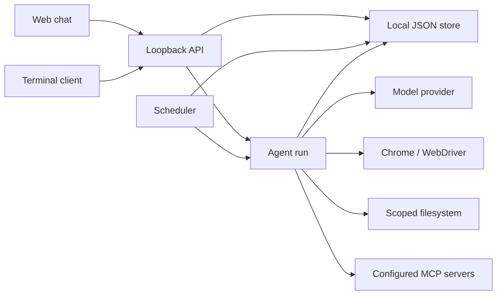

# Architecture

[Project README](../README.md)

One process binds to loopback, serves embedded assets, stores durable state and runs the scheduler. The web and terminal clients use the same API. There is no hosted backend.

## Source map

| Location | Responsibility |
| --- | --- |
| `cmd/liteagent/main.go` | Process entry |
| `internal/app/service.go` | Flags, listener, data lock, startup/shutdown |
| `internal/app/lifecycle.go`, `mode_*.go`, `process_*.go` | Desktop relaunch checks, Quit endpoint, build mode and child console behavior |
| `internal/app/server.go` | Routing, public state, run launch/cancellation, chat deletion |
| `internal/app/agent.go` | Context and model/tool loop |
| `internal/app/provider.go`, `responses.go` | Model protocols |
| `internal/app/filesystem.go`, `desktop_*.go` | File tools and Desktop discovery |
| `internal/app/browser.go`, `driver.go` | WebDriver and driver installation |
| `internal/app/scheduler.go`, `schedules_api.go` | Jobs and durable occurrence claims |
| `internal/app/store.go` | Serialized state mutations and atomic persistence |
| `internal/app/commands.go`, `chat_commands.go`, `cli.go` | Commands and terminal client |
| `internal/app/connections.go`, `settings.go`, `mcp.go` | Connections, generation settings, MCP |
| `internal/app/notifications.go` | Completed events for browser alerts |
| `web/` | Embedded chat, settings and notifications |

Tests live beside implementation. The `web` package embeds only UI files, excluding runtime data and documentation screenshots.

## Execution

`runMu` serializes active-run transitions. A run persists its chat/record and captures configuration before starting the worker. The worker saves events and final status, finishes any linked schedule and clears active state. Cancellation stops requests and closes tools; it cannot undo completed actions.

Deleting another chat leaves the active run alone. Deleting the active chat marks it pending, cancels and waits on its completion channel without holding `runMu`. The chat, runs and linked schedules are then removed in one store update. An interrupted delete request keeps the conversation for a later retry.

Filesystem operations use a separate lock. Store updates do not take that lock. Avoid waiting for a worker while holding any lock it needs.

## Persistence and schedules

`Store.Update` serializes mutations and writes a complete replacement state file. Failed mutation/save restores prior in-memory state. Startup marks unfinished runs interrupted and pauses affected jobs. An OS file lock prevents two services from using the same data directory.

The scheduler checks every five seconds. An occurrence and its run are claimed in one transaction. Agent jobs wait while another operation is active; reminders can be recorded immediately. Missed occurrences run once on return. Failed/interrupted jobs pause instead of automatically retrying actions.

## Interface

The UI polls state and ignores stale responses using a revision counter. The composer opens a compact model/reasoning panel. Saved credentials never enter public state. Notification preferences and delivery markers are browser-local; desktop alerts require permission and audio requires a page interaction.

`web/setup.js` renders Ollama setup and handles Quit. Installed Ollama models refresh while idle; the UI distinguishes an unreachable server, an empty list and a missing saved model. Discovery lists names without downloading weights or invoking inference. The Windows desktop build reuses a matching running instance, logs diagnostics locally and exits through the same cancellation/cleanup path as the console build.

See [Filesystem](FILESYSTEM.md) and [Data](DATA.md) for boundaries and limits.
