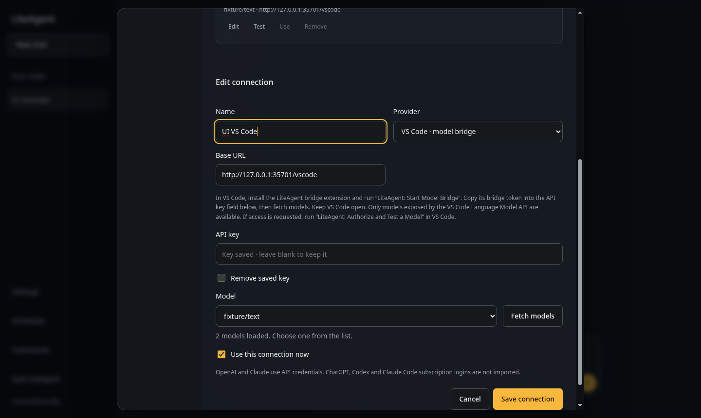

# Use VS Code as LiteAgent's model provider

[Project README](../README.md)

The optional **LiteAgent VS Code Bridge** extension routes LiteAgent requests through the public VS Code Language Model API:

```text
LiteAgent → local bridge extension → selected VS Code model
         ← text and tool calls    ← model response
```

LiteAgent keeps its own chats, browser/file tools and scheduler. VS Code supplies access to the selected language model. This does not run VS Code's own agent or mirror its chat panel.

## Build and install

Use the updated LiteAgent source. From its project folder, build the extension:

```bash
python3 scripts/build-vscode-bridge.py
```

On Windows, use `py scripts/build-vscode-bridge.py`. Packaging needs Python and Node.js 22+ with npm. The script downloads a pinned version of Microsoft's VS Code packaging tool and creates **`dist/LiteAgent-vscode-bridge.vsix`**. This generated file is local and excluded from Git; no Marketplace or GitHub binary release is published.

In desktop VS Code 1.104 or newer, open **Extensions → … → Install from VSIX** and choose that file. Rebuild/restart LiteAgent as described in the [README](../README.md#run-from-github-source) to see its new provider option.

## Connect

1. Enable a provider in VS Code that exposes models through its Language Model API.
2. Open VS Code's command palette with Ctrl+Shift+P and run **LiteAgent: Start Model Bridge**.
3. Run **LiteAgent: Copy Bridge Token**.
4. In LiteAgent, open **Settings → Models & keys → Add**. Name the connection, choose **VS Code · model bridge**, and keep **`http://127.0.0.1:8788/v1`** unless you changed the bridge port.
5. Paste the bridge token in **API key**, fetch models, choose one and save.
6. If LiteAgent reports missing model access, run **LiteAgent: Authorize and Test a Model** in VS Code. Choose the model and accept VS Code's access prompt. That command sends one short test request using your provider account. Then retry your message in LiteAgent.



The token is for the local bridge, not a remote provider key. Credentials saved by other extensions are not copied into LiteAgent. Available models and account limits come from VS Code and its providers. The model chosen in LiteAgent is used; changing the model in VS Code's chat panel does not change LiteAgent's choice.

## When something is unavailable

| Situation | What to do |
| --- | --- |
| Cannot connect | Keep VS Code open and run Start Model Bridge. Verify the port. |
| No models listed | Configure a provider exposing models through `vscode.lm`. A separate chat extension may expose no models to this API. |
| Missing bridge token / 401 | Copy the bridge token and save it in the connection. |
| Model access / 403 | Use Authorize and Test a Model in VS Code. |
| Model removed / 404 | Fetch models again and choose an available ID. |
| Blocked / 429 | Check provider access and quota in VS Code. The bridge does not bypass limits. |
| Tool request rejected | Choose a model that supports the tools LiteAgent sends. A successful text test does not establish tool support. |
| Context too large | Start a new chat or reduce LiteAgent's history/context. |
| Timeout | Check both LiteAgent's request/run deadline and VS Code's **LiteAgent Bridge: Timeout Seconds**. The bridge defaults to 900 seconds. |

The bridge stays local to the desktop computer running VS Code, including when a workspace uses SSH or WSL. Run LiteAgent on that same computer. Each independent VS Code bridge requires a different port. A reload/close stops the bridge; run Start Model Bridge after reopening. Reminders without inference remain LiteAgent jobs, while model-backed jobs require the bridge and model access at execution time.

## Supported behavior

Text messages, function-call definitions, tool calls/results and Stop cancellation are translated through VS Code's public API. LiteAgent executes the tools. Responses are returned only after the model finishes; a broken response stream never returns partial tool calls for execution. No request is retried automatically by the bridge.

The public consumer API provides user and assistant roles, so system instructions are placed at the start of user-message content. This changes their priority. The bridge uses model defaults for reasoning, temperature and output tokens. Images, structured output and arbitrary provider options are unsupported. It enforces context checks, 2 MiB request/response bounds and a maximum of eight simultaneous bridge requests.

Use **LiteAgent: Stop Model Bridge** or the status bar to stop it. **LiteAgent: Rotate Bridge Token** stops it and invalidates the previous token; copy the replacement to LiteAgent before restarting. Tokens are stored using VS Code SecretStorage. The extension forwards the context you send, without reading other chats/workspace files or recording prompts/responses. Provider data handling still applies.

The bridge has automated protocol tests and an isolated VS Code host test with a synthetic model, plus Chrome tests of LiteAgent's connection settings. These do not establish access, quota, answer quality or tool reliability for a real provider account. See [Development](DEVELOPMENT.md) and the [extension source](https://github.com/slgarza/LiteAgent/tree/main/extensions/vscode-bridge).

References: [VS Code Language Model API](https://code.visualstudio.com/api/extension-guides/ai/language-model), [Language Model API reference](https://code.visualstudio.com/api/references/vscode-api#lm), [VSIX packaging](https://code.visualstudio.com/api/working-with-extensions/publishing-extension).
