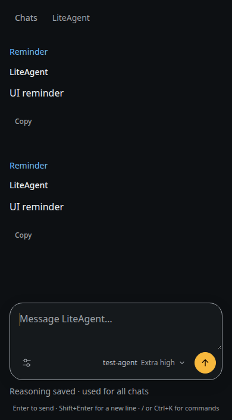

# Screenshots

[Project README](../../README.md)

Generated by `TestWorkspaceUI` with temporary state and local fake providers. “UI reminder” and “test-agent” are fixtures. No live conversations, API keys, account sessions or personal files are captured.

| Image | Requested window size | View |
| --- | --- | --- |
| [Desktop chat](chat-desktop.png) | 1440 × 1000 | Composer with model/reasoning |
| [Model menu](model-menu.png) | 1440 × 1000 | Model and reasoning choices |
| [Schedules](schedules.png) | 1440 × 1000 | Crons and reminders |
| [Notifications](notifications.png) | 1440 × 1000 | Alerts and sound preferences |
| [Mobile chat](chat-mobile.png) | 390 × 844 | Compact composer |

Chrome's captured viewport can be shorter than the requested window size because of browser chrome. See [Development](../DEVELOPMENT.md) for generation instructions. Visually inspect replacements before copying them here.

